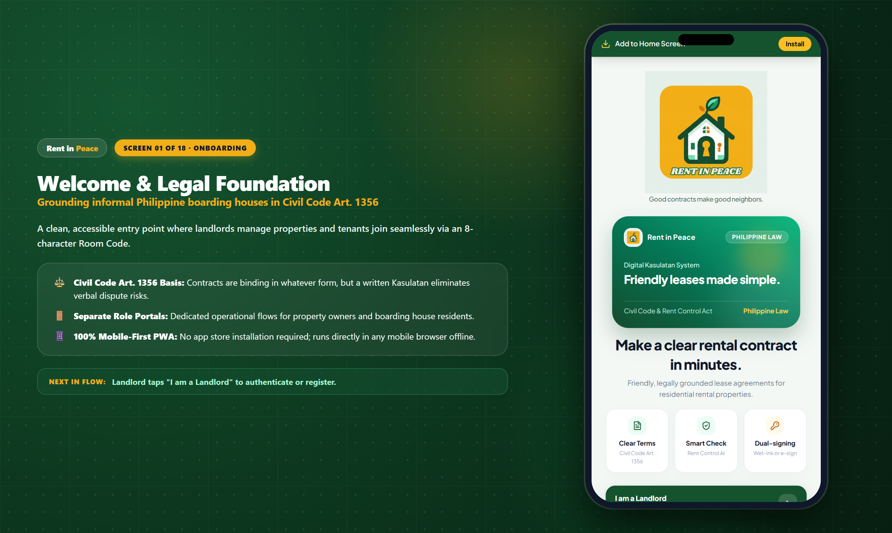
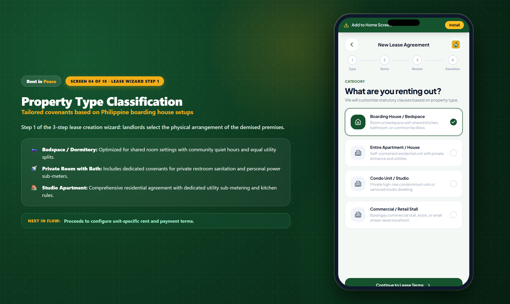
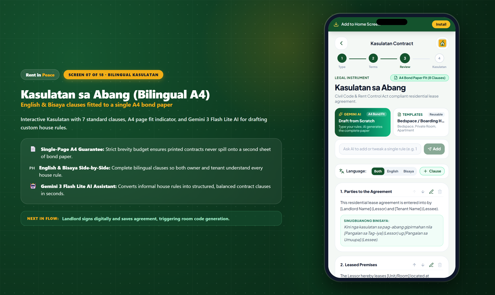
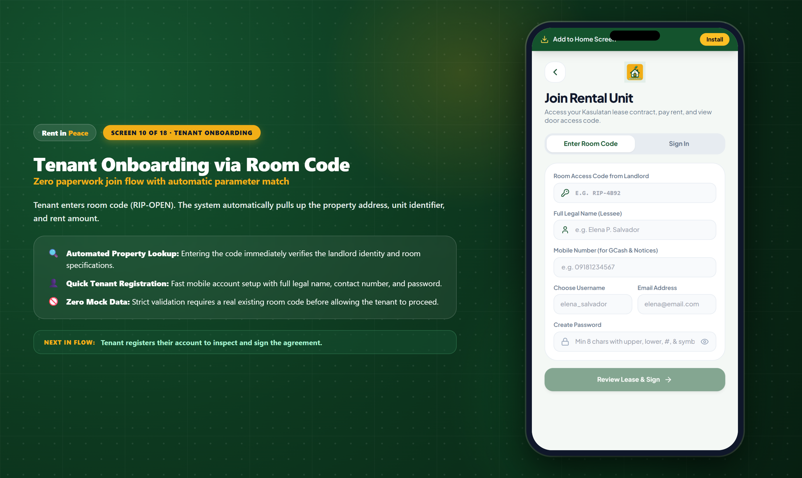
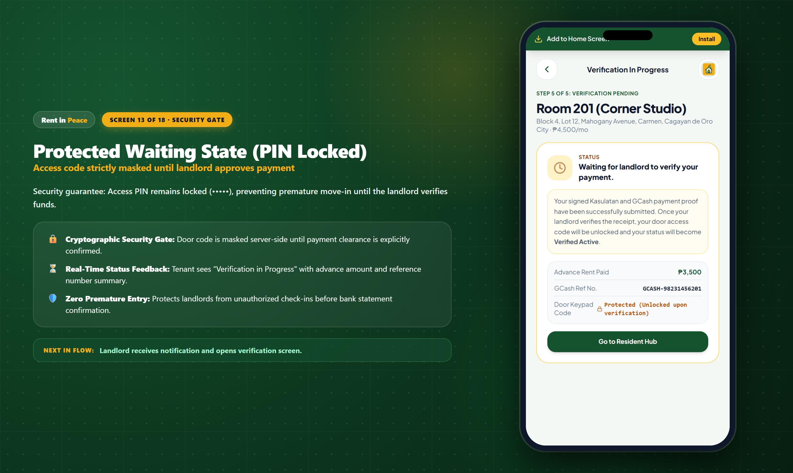

# <p align="center"></p>

<p align="center">
  <strong>Autonomous Residential Lease & Digital Rental Ledger Platform for Philippine Boarding Houses</strong><br>
  <em>Built for Google Developer Group (GDG) Cagayan de Oro · Road to DevFest 2026 Buildathon</em>
</p>

<p align="center">
  
  
  
  
</p>

---

## 🌟 Executive Pitch & The 30-Second Stage Hook

> **The Stage Hook:**
> *"In the Philippines, 4.8 million students and workers live in informal boarding houses, bedspaces, and dorms transacting over \$1.2 Billion annually. Yet, 90% of these rentals run on verbal promises, scrap paper notebooks, lost keys, and fake GCash screenshots. Existing property management tech requires expensive US smart locks and \$200 monthly fees. **Rent in Peace** is the world's first **100% software-only, zero-hardware lease and rental ledger platform** built for Philippine reality. Powered by **Google Gemini 3 (Gemini 3.5 Flash Lite / 3.1 Flash Lite)**, it turns plain house rules into single-page bilingual A4 Kasulatan agreements, audits GCash payments, and releases digital door keypad PINs—working seamlessly with ₱800 Shopee keypad locks without a single wire or IoT hub."*

---

## 🎤 Official Stage Pitch Deck (DevFest 2026 Presentation)

### 📊 Slide 1: The Invisible Housing Giant of the Philippines
- **4.8 Million Filipinos** live in informal boarding houses, bedspaces, and dormitories across university belts and urban hubs (*Cagayan de Oro, Metro Manila U-Belt, Cebu IT Park, Davao, Iloilo, Baguio*).
- **₱65 Billion ($1.2 Billion USD)** transacts annually in this informal rental economy—almost exclusively through unrecorded cash handovers, verbal *"sabot-sabot"*, and unverified GCash screenshots sent over Facebook Messenger.
- **The Mom-and-Pop Reality:** 92% of boarding house operators are retired teachers, Overseas Filipino Worker (OFW) families, or local homeowners managing 3 to 15 beds. They cannot afford enterprise software (DoorLoop, Buildium) or \$250 IoT smart lock hardware that requires reliable Wi-Fi and electric installation.

---

### 💥 Slide 2: The Triple Pain Points (The "Usapang Lalaki" Trap)

```
┌──────────────────────────────────────────────────────────────────────────────┐
│                    THE ARCHAIC BOARDING HOUSE BREAKDOWN                      │
├──────────────────────────┬──────────────────────────┬────────────────────────┤
│ 1. The Deposit Trap      │ 2. The Rule Ambiguity    │ 3. The Key & Fraud Trap│
│   #1 Barangay dispute    │   Unwritten curfews,     │   Lost keys cost ₱800+ │
│   in university towns;   │   unauthorized guests,   │   lock replacements;   │
│   landlords withhold     │   unmetered electric     │   fake or recycled     │
│   deposits with no proof │   surcharges & fights    │   GCash references     │
└──────────────────────────┴──────────────────────────┴────────────────────────┘
```

1. **The Disputed Security Deposit (#1 Barangay Lupon Case):** When a student moves out, landlords frequently invent deductions or claim the deposit was *"consumable"*, leaving students without the funds needed for their next dorm.
2. **House Rule Ambiguity & Electric Bill Shock:** Unwritten rules about 10:00 PM curfews, unauthorized sleepovers (*"nakikitulog na bisita"*), and informal electricity splits (*"₱15 per kilowatt without sub-meter receipt"*) lead to constant hostility.
3. **Missing Receipts & Insecure Key Handovers:** Tenants lose GCash reference SMS messages; landlords spend hours scrolling through personal bank notifications to reconcile payments; physical keys are left under doormats, and when a tenant moves out, the landlord must replace the entire padlock.

---

### 💡 Slide 3: The Breakthrough — 100% Software-Only Architecture

Instead of requiring expensive IoT locks connected to cloud servers, Rent in Peace pairs with **affordable mechanical or battery-powered keypad door locks (₱700–₱1,200 on Shopee/Lazada)**.

The software platform acts as the **cryptographic access gatekeeper**:
1. **Bilingual A4 Kasulatan Generator**: Landlord creates a legally grounded agreement in English and Bisaya in under 2 minutes.
2. **Gemini 3.5 Flash Lite AI Customizer**: Landlord enters plain house rules; Gemini drafts single-page A4 clauses.
3. **Frictionless Mobile E-Signing**: Tenant joins via 8-character Room Code (`RIP-OPEN`) and signs on their phone.
4. **Anti-Duplicate GCash Audit**: Tenant submits payment proof; landlord verifies the reference against their bank statement.
5. **Keypad Access PIN Release**: Once verified, the system generates a unique 5-digit door PIN (`48291`) revealed to the tenant for keyless move-in. Landlord can revoke or regenerate the PIN at any time.

---

### 👑 Slide 4: Landlord Operational Hub & End-to-End Flow

<p align="center">
  
</p>

1. **Register & Dashboard Setup**: Landlord signs up with full name, contact, and property address. Password strength is evaluated live.
2. **Lease Drafting**: Landlord picks a property type, inputs unit number and financial terms (e.g. ₱3,500/mo, 1 month advance, 1 month deposit).
3. **Kasulatan Customization**: Review 7 bilingual clauses in English and Bisaya. Reorder or edit terms to fit single-page A4.
4. **Publish & Share Room Code**: Agreement is finalized; platform generates a permanent 8-character code (`RIP-XXXX`) and copyable invite link.
5. **GCash Audit & Verification**: When tenant submits payment, the Action Required alert opens receipt zoom. Landlord taps "Verify & Release Code".
6. **Keypad PIN Issued**: A secure 5-digit PIN is generated and linked to the contract.

---

### 👤 Slide 5: Tenant Resident Journey & Frictionless Move-In

<p align="center">
  
</p>

1. **Join Unit**: Tenant enters the room code or clicks the shared invite link. Property and rent terms populate automatically.
2. **Read & E-Sign**: Tenant toggles between English and Bisaya explanations, agrees to terms, and signs on-screen.
3. **Pay Initial Rent**: Tenant sends GCash transfer to landlord's QR/number, uploads receipt screenshot, and inputs reference number.
4. **Waiting State**: Door PIN is locked while landlord audits payment.
5. **Instant Move-In**: Upon landlord verification, the door PIN unlocks with a single tap to copy for keypad entry.

---

### 🤖 Slide 6: The AI Legal Moat — Google Gemini 3.5 Flash Lite

```
[Landlord Input] ➔ "Curfew at 10 PM. Visitors allowed until 8 PM only. No overnight guests."
                           │
                           ▼
[Model 1: Gemini 3.5 Flash Lite (500 RPD, 15 RPM)] ➔ Fast Primary Engine
   │ (Transient error or 429)
   ▼
[Model 2: Gemini 3.1 Flash Lite (500 RPD, 15 RPM)] ➔ Automated Secondary Failover
   │ (Transient error or 429)
   ▼
[Model 3: Gemini 3 Flash Preview (20 RPD, 5 RPM)]  ➔ Tertiary Failover
                           │
                           ▼
[Editable Bilingual Clause Pair]
├── English: "The Lessee agrees to observe quiet hours starting at 10:00 PM. Visitors are permitted..."
└── Sinugbuanong Binisaya: "Ang Umuupa mouyon sa pagtahod sa takna sa kalinaw sugod sa alas 10:00 sa gabii..."
                           │
                           ▼
[Landlord Explicit Review & Confirmation] (Never auto-inserted without review)
```

- **Sub-Second Latency**: Generates bilingual clauses in under 800ms directly on the client.
- **Native Bisaya Understanding**: Correctly translates nuanced regional terminology (*"Umuupa"*, *"Nagpaabang"*, *"Abang"*, *"Pahibalo"*).
- **Strict Single-Page A4 Guarantee**: The system prompt budgets clause length to ensure printed contracts never spill onto a second sheet of bond paper.
- **Responsible AI Disclaimer**: Never makes false claims of statutory enforceability or legal representation; clearly advises the landlord to review all terms.

---

### 📈 Slide 7: Market Opportunity & Unit Economics

| Total Addressable Market (TAM) | Serviceable Addressable Market (SAM) | Serviceable Obtainable Market (SOM) |
|:---:|:---:|:---:|
| **₱65 Billion ($1.2B)**<br>4.8M informal renters in the Philippines | **₱18 Billion ($330M)**<br>1.2M bedspaces in university & BPO hubs | **₱54 Million ($1M)**<br>25,000 boarding house rooms in Year 1 |

- **Freemium Tier (100% Free Forever)**: Up to 3 rooms free. Zero friction for small mom-and-pop landladies.
- **Pro Landlord Subscription (₱199/month or ₱1,999/year)**: Unlimited units, Gemini AI Kasulatan generation, custom preset library, and multi-month accounting export.
- **Smart Lockbox Hardware Affiliate (₱120 per unit)**: 10% commission on ₱1,200 Shopee/Lazada mechanical keypad lockboxes and keypad locks recommended inside the app.
- **Unit Economics**: CAC: ₱150 · ARPU: ₱199/mo · LTV: ₱4,776 (24-mo retention) · **LTV / CAC: 31.8x**!

---

### 🏆 Slide 8: Competitive Moat

| Feature | Rent in Peace | US Property SaaS (DoorLoop, Buildium) | Manual Paper / Excel | Facebook Messenger + GCash |
|---|:---:|:---:|:---:|:---:|
| **Hardware Required** | **₱0 (Software-Only)** | \$250+ IoT Smart Lock per door | None | None |
| **Monthly Pricing** | **Free / ₱199/mo** | \$200+/month | Free | Free |
| **Bilingual A4 Kasulatan** | **✅ English + Bisaya** | ❌ English only | ❌ Hand-written | ❌ None |
| **AI Clause Assistant** | **✅ Gemini 3.5 Flash Lite** | ❌ None | ❌ None | ❌ None |
| **Door Access Keypad Gating**| **✅ Cryptographic PIN** | ❌ Requires Cloud IoT Hub | ❌ Physical keys | ❌ None |
| **Offline PWA Support** | **✅ Works on 3G / Offline**| ❌ Heavy Cloud App | ❌ Vulnerable paper | ❌ Needs Internet |
| **Philippine Rent Control Cap**| **✅ Built-in Alert** | ❌ US Law Only | ❌ None | ❌ None |

---

## 📱 Complete Presentation Gallery (High-Resolution Widescreen Slides)

All 18 slides have been captured with side-by-side pitch explanations and large, crisp mobile app mockups (`docs/pitch/*-framed.png`):

### 👑 Landlord Operational Flow

| Step & Slide | Widescreen Presentation Slide | Key Takeaways & Actions |
|---|:---:|---|
| **01. Welcome Splash** |  | Civil Code Art. 1356 legal foundation, distinct role portals, and offline PWA capability. |
| **02. Landlord Auth** |  | Live password entropy scoring (zxcvbn), self-serve password reset, and secure session management. |
| **03. Landlord Dashboard** |  | Live monthly rent roll (₱13,000/mo), Action Required verification alert banner, and room code sharing. |
| **04. Property Type** |  | Step 1 of lease wizard: select between Bedspace, Private Room with Bath, or Studio Apartment. |
| **05. Contract Basics** |  | Step 2: enter unit identifier, property address, monthly rent, and automated advance/deposit calculation. |
| **06. Review Summary** |  | Step 3: pre-flight validation summarizing total move-in balance, rent schedule, and Rent Control Act caps. |
| **07. A4 Kasulatan** |  | 7 bilingual clauses in English and Bisaya, A4 single-page fit budget, and Gemini 3.5 Flash Lite drafting. |
| **08. Preset Customizer** |  | Landlord preset library: Bedspace, Room with CR, and Studio Apartment with dynamic placeholders (`{{rent}}`, `{{unit}}`). |
| **09. Room Code Ready** |  | Published lease showing unique 8-character Room Code (`RIP-OPEN`) and one-click Share/Copy Link button. |

### 👤 Tenant Resident Flow

| Step & Slide | Widescreen Presentation Slide | Key Takeaways & Actions |
|---|:---:|---|
| **10. Tenant Join** |  | Tenant registration screen where room code automatically pre-fills unit and landlord parameters. |
| **11. Tenant E-Sign** |  | Tenant portal with one-tap Bisaya language toggle, legal checklist, and touchscreen signature pad. |
| **12. GCash Upload** |  | Payment submission interface with screenshot attachment and 12-digit GCash reference number input. |
| **13. PIN Locked State** |  | Protected security gate: access PIN is masked while landlord verifies GCash receipt against bank records. |

### 🔒 Payment Verification & Keypad Access Release

| Step & Slide | Widescreen Presentation Slide | Key Takeaways & Actions |
|---|:---:|---|
| **14. Payment Audit** |  | Landlord audit desk: receipt zoom, reference comparison, Verify & Issue Code button, and Reject with reason. |
| **15. Door PIN Issued** |  | Verified lease view displaying active 5-digit door access code (`48291`) with regenerate and revoke controls. |
| **16. Tenant Hub** |  | Verified Active home view: Maria Santos sees assigned unit, door PIN (`48291`), agreement copy, and rent logger. |

### 📊 Management & Accounting Ledger

| Step & Slide | Widescreen Presentation Slide | Key Takeaways & Actions |
|---|:---:|---|
| **17. Unified Search** |  | Instant search filtering across room codes, access PINs, tenant names, and GCash reference numbers. |
| **18. Payment Ledger** |  | Multi-month transaction ledger tracking advance rent, security deposit, and subsequent monthly rent cycles. |

---

## 🎨 Design Tokens & Brand System

Extracted directly from the official logo files (`public/assets/logo-full.png` and `public/assets/logo-icon.png`):

| Role | Token Name | Hex Code | Visual Application |
|---|---|---|---|
| **Primary** | Deep Forest Pine | `#144C2E` / `#14532D` | Brand headers, primary CTA buttons, and active status borders |
| **Secondary** | Foliage Leaf Green | `#449567` | Secondary accents, progress indicators, and subtle badges |
| **Accent** | Warm Amber Gold | `#F1AE17` | Action-required alerts, notification halos, and pending tags |
| **Canvas** | Soft Sage Canvas | `#E4EFE9` | Anti-glare mobile app background |
| **Surface** | Clean White Card | `#FFFFFF` / `#F4F8F5` | Elevated modal sheets and card surfaces |
| **Text Primary** | Deep Slate Ink | `#0F172A` / `#1E293B` | High legibility clause text and headers |
| **Text Muted** | Sage Slate Neutral | `#527060` / `#64748B` | Helper captions, subheadings, and secondary metadata |
| **Success** | Verified Emerald | `#16A34A` | Verified payment status badges and active lease indicators |
| **Error** | Crimson Red | `#DC2626` | Rejection alerts and field validation errors |

---

## 🛠️ Technology Stack

- **Frontend**: React 19, Vite 8.3, Tailwind CSS with custom design tokens (`src/styles/tokens.css`).
- **Typography**: Plus Jakarta Sans.
- **Icons**: Lucide React.
- **Backend & Cloud**:
  - **Firebase Auth**: User account management with password strength scoring.
  - **Cloud Firestore**: Real-time lease status, preset library, and payment ledger sync.
  - **Firebase Storage**: Secure storage for GCash transaction receipts and ID cards.
- **Artificial Intelligence**: Google Gemini 3 (Gemini 3.5 Flash Lite / 3.1 Flash Lite) via REST API.
- **Automated Tooling**: Puppeteer Core (high-res screenshot capture), Oxlint.

---

## 🚀 Local Setup & Pitch Demo Instructions

### Prerequisites
- Node.js `v18.0.0` or higher
- npm `v9.0.0` or higher

### Installation & Launch
```bash
# Clone the repository
git clone https://github.com/devfest-buildathon/rent-in-peace.git
cd rent-in-peace

# Install dependencies
npm install

# Configure environment variables
cp .env.example .env

# Start local development server
npm run dev
```

### Safe Database Reset & Mock Seeding (For Pitching)
To reset the database and seed realistic demo data for presentations:
```bash
# Safety rule: DEMO_PROJECT_ID must match your target project ID, and requires --confirm
DEMO_PROJECT_ID=rentinpeace npm run demo:reset -- --confirm
```

### 🔑 Demo Pitch Login Credentials

#### 👑 Landlord Account
- **Mobile / Username**: `09171234567`
- **Password**: `Password123!`
- **Name**: Engr. Roberto M. Tan
- **Property**: Tan Residence, Mahogany Avenue, Carmen, Cagayan de Oro City
- **Units Seeded**: 4 leases (`RIP-OPEN`, `RIP-PEND`, `RIP-ACTV`, `RIP-REJC`)

#### 👤 Tenant Resident Account
- **Mobile / Username**: `09181112222`
- **Password**: `Password123!`
- **Name**: Maria Teresa Santos
- **Room Assignment**: Room 201 (Corner Studio) · `RIP-ACTV`
- **Active Keypad Access PIN**: `48291`

---

## ⚖️ Legal & Responsible AI Disclaimer

*Rent in Peace is an operational management, record-keeping, and mutual transparency tool for residential rentals in the Philippines. It does not provide legal representation or formal statutory advice. All AI-generated clauses produced by Google Gemini must be explicitly reviewed and confirmed by the property owner before commitment. The platform strictly enforces statutory tenant caps under the Philippine Rent Control Act (Republic Act No. 9653).*

### Philippine Legal Framework Alignment

| Legal Framework | Implementation in Rent in Peace |
|---|---|
| **RA 386 (Civil Code Art. 1356)** | Customary residential lease format enforceable for barangay proceedings and informal dispute resolutions. |
| **Civil Code Art. 1654 & 1687** | Prescribed statutory landlord maintenance covenants and 30-day move-out notification periods. |
| **Rent Control Act of the Philippines** | Deposit caps (1 month advance, 1 to 2 months security deposit) automatically enforced in the wizard. |
| **RA 8792 (E-Commerce Act)** | Electronic signatures recorded with cryptographic timestamps and PhilSys-verified legal name binding. |
| **RA 10173 (Data Privacy Act)** | Strict isolation ensures co-tenants cannot view other tenants' balances, receipts, or contracts. |

---

## 🗄️ Database Collections (Cloud Firestore)

- **`contracts/`**: Holds lease agreements, clause lists, room metadata, lockbox PINs, and verification flags (`paymentVerified: boolean`).
- **`tenants/`**: Tenant credentials (username, password hash/pin), full legal names, and linked contract codes.
- **`landlords/`**: Landlord profiles, registered phone numbers, property locations, and PINs.
- **`payments/`**: Ledger entries with contract codes, cycle names, amounts, GCash reference numbers, and receipt image attachments.
- **`checkins/`**: Audit trail of digital signatures, check-in timestamps, and tenant IDs.

---

## 🧪 Testing the Live Demo

1. **Landlord Flow:**
   - On the Splash Screen, click **Landlord Portal** -> **Create Account** or **Sign In**.
   - Tap **"Create a new contract"**, fill out unit details (e.g. Unit 4, ₱3,500/mo), customize clauses with Gemini AI, and save.
   - Share the room code (e.g. `RIP-XXXX`) or copy the invite link.
2. **Tenant Flow:**
   - Open the link with `?code=RIP-XXXX` or click **Tenant Portal** -> **Register**.
   - Input your username and password.
   - Land directly on your **Tenant Dashboard**: view your contract, pay rent via GCash, track your monthly schedule, and view lockbox status.
3. **Verification Flow:**
   - Tenant submits rent with a GCash ref.
   - Landlord dashboard shows **"Action Required: Tenant Payment Pending"**.
   - Landlord clicks **"Verify Payment & Grant Room Key Access"**.
   - Tenant dashboard instantly unlocks Smart Keybox PIN `48291`!

---

## 👥 The Team Behind Rent in Peace (GDG CDO Buildathon 2026)

| Member | Role | Responsibilities & Contributions |
|---|---|---|
| **Danlord Farell Soriano (Daf)** ([@Daffy-Ducky](https://github.com/Daffy-Ducky)) | **Team Lead & System Architect** | System prompts, stage pitch presenter, Phygital dual-signing architecture, feature orchestration |
| **Pia Paña** (@pyuuh) | **Lead UI/UX Designer** | Figma 10-screen design system, branding, color palette, typography |
| **Justine Roy Salva** ([@JRSstuff](https://github.com/JRSstuff)) | **Lead Backend & AI Engineer** | Google Gemini Flash integration, Cloud Firestore schemas, in-app GCash logic |
| **John Kurt** | **Co-Developer & DevOps** | Deployment, persistence validation, PWA caching |

---

## 📄 License
Licensed under the [MIT License](LICENSE).
