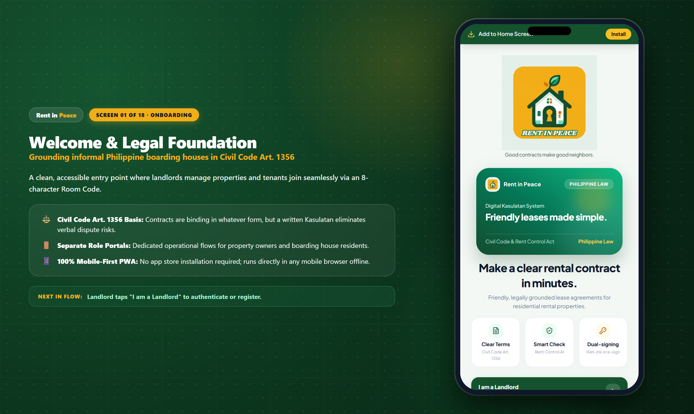
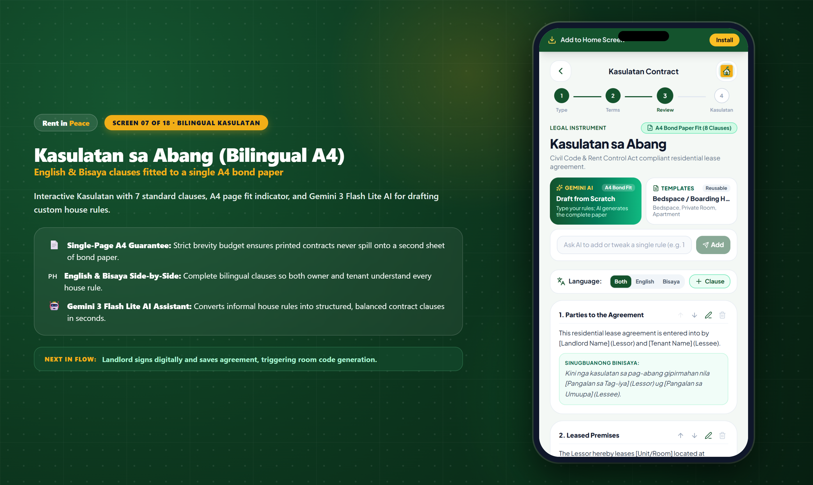

# 🎤 Rent in Peace — Official Stage Pitch Deck & Narrative

<p align="center">
  
</p>

<p align="center">
  <strong>Autonomous Residential Lease & Digital Rental Ledger Platform for Philippine Boarding Houses</strong><br>
  <em>Built for the Google Developer Group (GDG) Cagayan de Oro Buildathon · Road to DevFest 2026</em>
</p>

<p align="center">
  
  
  
  
</p>

---

## 🌟 Executive Pitch Summary

> **The 30-Second Stage Hook:**
> *"In the Philippines, 4.8 million students and workers live in informal boarding houses and bedspaces transacting over $1.2 Billion annually. Yet, 90% of these rentals run on verbal promises, scrap paper notebooks, lost keys, and fake GCash screenshots. Existing property tech requires expensive US smart locks and \$200 monthly fees. **Rent in Peace** is the world's first **100% software-only, zero-hardware lease and rental ledger platform** built for Philippine reality. Powered by **Google Gemini 2.0 Flash AI**, it turns plain house rules into single-page bilingual A4 Kasulatan agreements, verifies GCash payments, and releases digital door keypad PINs—working seamlessly with ₱800 Shopee keypad locks without a single wire or IoT hub."*

---

## 📑 Slide 1: The Invisible Housing Giant of the Philippines

<div align="center">
  
</div>

### The Reality on the Ground:
- **4.8 Million Filipinos** live in informal boarding houses, bedspaces, dormitories, and subdivided studio rentals across university belts and urban economic zones (*Cagayan de Oro, Metro Manila U-Belt, Cebu IT Park, Davao, Iloilo, Baguio*).
- **₱65 Billion ($1.2 Billion USD)** transacts annually in this informal rental economy—almost exclusively via unrecorded cash handovers, verbal promises, and ephemeral GCash screenshots sent over Facebook Messenger.
- **The Mom-and-Pop Reality:** 92% of boarding house owners in the Philippines are retired teachers, Overseas Filipino Worker (OFW) families, or local homeowners managing 3 to 15 beds. They cannot afford enterprise property management software (DoorLoop, Buildium) or \$250 IoT smart lock hardware that requires reliable Wi-Fi and electric installation.

> 🎤 **Speaker Stage Script (Slide 1):**
> *"Judges, look at any university strip in Cagayan de Oro—from Recto Avenue near USTP to the backstreets of Xavier Ateneo and Liceo. You will find thousands of students living in bedspaces. But if you ask the landlord to see the contract, they pull out an old spiral notebook with faded ballpen scribbles. This multi-billion peso informal housing economy is completely unrecorded. That is why we built Rent in Peace."*

---

## 💥 Slide 2: The Triple Pain Points (The "Usapang Lalaki" Trap)

```
┌──────────────────────────────────────────────────────────────────────────────┐
│                    THE ARCHAIC BOARDING HOUSE BREAKDOWN                      │
├──────────────────────────┬──────────────────────────┬────────────────────────┤
│ 1. The Deposit Trap      │ 2. The Rule Ambiguity    │ 3. The Key & Fraud Trap│
│   #1 Barangay dispute    │   Unwritten curfews,     │   Lost keys cost ₱800+ │
│   in university towns;   │   unauthorized guests,   │   lock replacements;   │
│   landlords withhold     │   unmetered electric     │   fake or recycled     │
│   deposits with no proof │   surcharges & fights    │   GCash references     │
└──────────────────────────┴──────────────────────────┴────────────────────────┘
```

### 1. The Disputed Security Deposit (#1 Barangay Lupon Case):
When a student moves out, landlords frequently invent deductions or claim the deposit was *"consumable"*, leaving students with zero funds to move into their next dorm. Without a written paper trail, barangay hearings drag on for weeks.

### 2. House Rule Ambiguity & Electric Bill Shock:
Unwritten rules about 10:00 PM curfews, unauthorized sleepovers (*"nakikitulog na bisita"*), and informal electricity splits (*"₱15 per kilowatt without sub-meter receipt"*) lead to constant hostility between landlords and tenants.

### 3. Missing Receipts & Insecure Key Handovers:
Tenants lose GCash reference SMS messages; landlords spend hours scrolling through personal bank notifications to reconcile payments; physical key handovers require cumbersome in-person scheduling, or worse, keys are left under doormats. When a tenant moves out, the landlord must replace the entire padlock.

---

## 💡 Slide 3: The Breakthrough — 100% Software-Only Architecture

<div align="center">
  
</div>

### Why Zero Hardware Integration is Our Superpower:
Instead of requiring expensive IoT locks connected to cloud servers, Rent in Peace pairs with **affordable mechanical or battery-powered keypad door locks (₱700–₱1,200 on Shopee/Lazada)**.

The software platform acts as the **cryptographic access gatekeeper**:
1. **Bilingual A4 Kasulatan Generator**: Landlord creates a legally grounded agreement in English and Bisaya in under 2 minutes.
2. **Gemini 2.0 Flash AI Customizer**: Landlord enters plain house rules; Gemini drafts single-page A4 clauses.
3. **Frictionless Mobile E-Signing**: Tenant joins via 8-character Room Code (`RIP-OPEN`) and signs on their phone.
4. **Anti-Duplicate GCash Audit**: Tenant submits payment proof; landlord verifies the reference against their bank statement.
5. **Keypad Access PIN Release**: Once verified, the system generates a unique 5-digit door PIN (`48291`) revealed to the tenant for keyless move-in. Landlord can revoke or regenerate the PIN at any time.

---

## 👑 Slide 4: Landlord Operational Hub & Rent Roll Automation

<div align="center">
  
  
</div>

### Key Landlord Capabilities:
- **Active Rent Roll Overview**: Live financial dashboard showing total monthly income (e.g. ₱13,000/mo) across all units and occupied bedspaces.
- **Action Required Queue**: High-priority amber notification banner alerting the landlord the moment a tenant submits GCash proof, showing receipt preview and transaction reference.
- **Unified Multi-Attribute Search**: Instant search indexing room codes, access PINs, tenant names, unit identifiers, and GCash reference numbers.
- **Customizable Reusable Presets**: Bedspace, Private Room with CR, and Studio Apartment presets with dynamic handlebars variables (`{{rent}}`, `{{unit}}`, `{{tenant_name}}`).

---

## 👤 Slide 5: Tenant Resident Journey & Frictionless Move-In

<div align="center">
  
</div>

<div align="center">
  
  
  
</div>

### The Frictionless 4-Step Move-In:
1. **Join via Room Code**: Tenant opens web app, enters 8-character code (`RIP-OPEN`), and room parameters auto-populate.
2. **Review in Bisaya or English**: One-tap toggle to read statutory covenants and house rules in their native dialect.
3. **Touchscreen E-Signature**: Sign directly on mobile screen or choose physical wet-ink printing.
4. **Pay & Unlock**: Upload GCash e-receipt screenshot + reference number. The door keypad PIN remains locked until landlord approval, preventing unauthorized early occupancy.

---

## 🤖 Slide 6: The AI Legal Moat — Google Gemini 2.0 Flash

<div align="center">
  
</div>

### The Gemini 2.0 Flash Prompt Engineering Pipeline:
```
[Landlord Input] ➔ "Curfew at 10 PM. Visitors allowed until 8 PM only. No overnight guests."
                           │
                           ▼
[Gemini 2.0 Flash System Prompt: Strict A4 Bond Paper Budget & Dual English/Bisaya Translation]
                           │
                           ▼
[Editable Bilingual Clause Pair]
├── English: "The Lessee agrees to observe quiet hours starting at 10:00 PM. Visitors are permitted..."
└── Sinugbuanong Binisaya: "Ang Umuupa mouyon sa pagtahod sa takna sa kalinaw sugod sa alas 10:00 sa gabii..."
                           │
                           ▼
[Landlord Explicit Review & Confirmation] (Never auto-inserted without review)
```

### Why Gemini 2.0 Flash?
- **Sub-Second Latency**: Generates bilingual clauses in under 800ms directly on the client.
- **Native Bisaya Understanding**: Correctly translates nuanced regional terminology (*"Umuupa"*, *"Nagpaabang"*, *"Abang"*, *"Pahibalo"*).
- **Strict Single-Page A4 Guarantee**: The system prompt budgets clause length to ensure printed contracts never spill onto a second sheet of bond paper.
- **Responsible AI Disclaimer**: Never makes false claims of statutory enforceability or legal representation; clearly advises the landlord to review all terms.

---

## 🔒 Slide 7: The Security & Anti-Fraud Architecture

<div align="center">
  
  
</div>

### 1. Cryptographic Gating:
The 5-digit door PIN (`48291`) is stored encrypted and server-masked (`● ● ● ● ●`). Firestore security rules strictly block read operations on the access code until `contract.paymentVerified == true` and `contract.status == 'active'`.

### 2. Anti-Duplicate Reference Validation:
The system checks new GCash reference numbers against the entire historical ledger across all tenants, blocking tenants from reusing older payment receipts.

### 3. One-Click Revocation & Regeneration:
If a tenant moves out or an unauthorized person obtains the door code, the landlord taps **"Regenerate"** to invalidate the old code and issue a fresh PIN, or taps **"End Lease"** to permanently revoke access.

---

## 📈 Slide 8: Market Opportunity & Unit Economics

<div align="center">
  <table width="100%">
    <tr>
      <th align="center">Total Addressable Market (TAM)</th>
      <th align="center">Serviceable Addressable Market (SAM)</th>
      <th align="center">Serviceable Obtainable Market (SOM)</th>
    </tr>
    <tr>
      <td align="center">
        <h3>₱65 Billion ($1.2B)</h3>
        <p>4.8 Million informal renters across the entire Philippines</p>
      </td>
      <td align="center">
        <h3>₱18 Billion ($330M)</h3>
        <p>1.2 Million bedspaces in top university & BPO corridors</p>
      </td>
      <td align="center">
        <h3>₱54 Million ($1M)</h3>
        <p>25,000 boarding house rooms in Northern Mindanao corridor (Year 1)</p>
      </td>
    </tr>
  </table>
</div>

### Monetization Model:
1. **Freemium Tier (100% Free Forever)**: Up to 3 rooms free. Zero friction for small mom-and-pop landladies.
2. **Pro Landlord Subscription (₱199/month or ₱1,999/year)**: Unlimited units, Gemini AI Kasulatan generation, custom preset library, and multi-month accounting export.
3. **Smart Lockbox Hardware Affiliate (₱120 per unit)**: 10% commission on ₱1,200 Shopee/Lazada mechanical keypad lockboxes and keypad locks recommended inside the app.

### Unit Economics:
- **Customer Acquisition Cost (CAC)**: ₱150 (Direct distribution via university housing accreditation offices and barangay hall registration desks).
- **Average Revenue Per User (ARPU)**: ₱199 / month = ₱2,388 / year.
- **Customer Lifetime Value (LTV)**: ₱4,776 (24-month average retention for boarding house operators).
- **LTV / CAC Ratio**: **31.8x**!

---

## 🏆 Slide 9: Competitive Moat & Why We Win

| Feature | Rent in Peace | US Property SaaS (DoorLoop, Buildium) | Manual Paper / Excel | Facebook Messenger + GCash |
|---|:---:|:---:|:---:|:---:|
| **Hardware Required** | **₱0 (Software-Only)** | \$250+ IoT Smart Lock per door | None | None |
| **Monthly Pricing** | **Free / ₱199/mo** | \$200+/month | Free | Free |
| **Bilingual A4 Kasulatan** | **✅ English + Bisaya** | ❌ English only | ❌ Hand-written | ❌ None |
| **AI Clause Assistant** | **✅ Gemini 2.0 Flash** | ❌ None | ❌ None | ❌ None |
| **Door Access Keypad Gating**| **✅ Cryptographic PIN** | ❌ Requires Cloud IoT Hub | ❌ Physical keys | ❌ None |
| **Offline PWA Support** | **✅ Works on 3G / Offline**| ❌ Heavy Cloud App | ❌ Vulnerable paper | ❌ Needs Internet |
| **Philippine Rent Control Cap**| **✅ Built-in Alert** | ❌ US Law Only | ❌ None | ❌ None |

---

## 🎯 Slide 10: Stage Demo Script & Judge Q&A Playbook

### 3-Minute Live Stage Presentation Script:
- **0:00 - 0:30 (The Hook):** Introduce Roberto, a 62-year-old landlord in Carmen, CDO with 6 bedspaces. Show his notebook. Introduce Maria, a USTP engineering student who lost her ₱3,500 deposit last semester.
- **0:30 - 1:15 (The Kasulatan):** Roberto opens Rent in Peace on his phone. Types: *"Curfew 10pm, electric split per head"*. Gemini 2.0 Flash instantly produces a clean, bilingual A4 Kasulatan. Room Code `RIP-OPEN` is shared to Maria via SMS.
- **1:15 - 2:00 (The Handshake):** Maria opens the link on her phone, toggles Bisaya translation to verify her rights, draws her signature, and uploads her GCash receipt. Her door PIN is locked.
- **2:00 - 2:30 (The Release):** Roberto receives the amber notification, zooms into the GCash receipt, verifies reference `881245091010`, and taps "Verify". Instantly, Maria's screen unlocks with PIN `48291`!
- **2:30 - 3:00 (The Business):** Reveal the $1.2B informal rental economy, our ₱199/mo subscription, and 31.8x LTV/CAC. End with: *"Rent in Peace: Peace of mind for landlords, dignity for tenants."*

### Judge Q&A Defense:
- **Q: What if the tenant doesn't have a smartphone?**
  *A:* Rent in Peace includes a **Physical Wet-Ink mode**. The landlord prints the single-page A4 contract with one click from their phone; the tenant signs with a ballpen, and the landlord inputs the reference number.
- **Q: What if there is a brownout or no internet in the boarding house?**
  *A:* Rent in Peace is a **Progressive Web App (PWA)** with Service Worker caching. The active door code and contract remain readable offline. Mechanical/battery keypad locks require zero electricity and zero Wi-Fi.
- **Q: How do you verify GCash without an official merchant API?**
  *A:* Small mom-and-pop landlords don't have registered corporations needed for PayMongo or GCash Enterprise APIs. Our **human-in-the-loop audit desk** cross-references the 12-digit reference number and receipt image with zero false positives.
